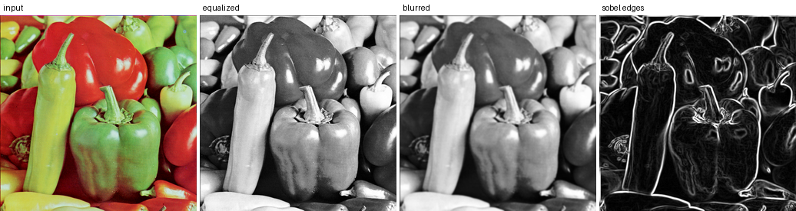

# GPU Batch Image Enhancement & Edge Detection with CUDA Streams

A CUDA C++ command-line tool that pushes a whole directory of images through
a GPU pipeline:

```text
RGB -> grayscale -> histogram equalization -> Gaussian blur -> Sobel edges
```

Every stage is a hand-written CUDA kernel (shared-memory histograms, a
parallel prefix scan, separable convolution with constant-memory weights and
shared-memory tiles, tiled Sobel). Images are spread over several CUDA
streams with pinned host buffers, so disk I/O, PCIe transfers and kernels for
different images overlap. A single-threaded CPU reference is included to
check that the GPU output is **bit-exact** and to measure the speedup.

It was built for the *CUDA at Scale for the Enterprise* independent project.



## Dataset

The [USC-SIPI Image Database](https://sipi.usc.edu/database/database.php):
all three volumes **Textures**, **Miscellaneous** and **Aerials**, which is
**141 images, 80.7 megapixels**:

| Volume   | Images | Sizes                         | Type               |
|----------|-------:|-------------------------------|--------------------|
| textures | 64     | 512x512, 1024x1024            | grayscale          |
| misc     | 39     | 256x256 - 1024x1024           | grayscale and RGB  |
| aerials  | 38     | 512x512 - 2250x2250           | grayscale and RGB  |

The mix of many small images and some large ones covers both halves of the
assignment's data requirement. `scripts/prepare_data.py` downloads the
volumes and converts the TIFFs to binary PGM/PPM. The C++ code has its own
Netpbm reader/writer, so there are no image-library dependencies.

## GPU algorithms

| Stage | Kernel(s) | Key techniques |
|-------|-----------|----------------|
| Color to gray | `RgbToGrayKernel` | grid-stride loop, integer luma `(77R+150G+29B+128)>>8` |
| Histogram | `HistogramKernel` | per-block histogram in **shared memory** with shared atomics, one global merge per bin |
| Equalization LUT | `BuildEqualizationLutKernel` | one 256-thread block, **Hillis-Steele inclusive scan** for the CDF, exact 64-bit integer mapping |
| Apply LUT | `ApplyLutKernel` | LUT cached in shared memory |
| Gaussian blur | `GaussianRowKernel`, `GaussianColumnKernel` | **separable** convolution, weights in **`__constant__` memory**, 16x16 tiles + apron staged in shared memory, clamp-to-edge |
| Sobel | `SobelKernel` | 18x18 shared-memory tile with a 1-pixel apron, gradient magnitude, optional binarization |

Host side (`BatchProcessor`):

* A pool of N **slots**, each with its own `cudaStream_t`, pinned
  (`cudaMallocHost`) input/output buffers, device buffers and a pair of
  `cudaEvent_t` for timing.
* Images are assigned to slots round-robin. While slot *k* is on the GPU,
  the host is already reading the next image from disk for slot *k+1*.
* Buffers only grow, to the largest image seen so far, so the steady state
  does no `cudaMalloc`.
* A failing CUDA call aborts with file and line (`CUDA_CHECK`), in line with
  Google style's no-exceptions rule.

## Repository layout

```text
src/
  main.cc               CLI entry point, summary, CSV report, CPU verification
  command_line.{h,cc}   flag parsing (--name=value / --name value)
  batch_processor.{h,cu} multi-stream batch engine
  kernels.{cuh,cu}      all CUDA kernels + launchers
  reference_filters.{h,cc} CPU reference (verification and speedup only)
  image_io.{h,cc}       PGM/PPM reader/writer, directory listing
  operation.h           operation enum
  cuda_check.h          CUDA error-check macro
scripts/
  prepare_data.py       download SIPI volumes, convert TIFF to PGM/PPM
  make_previews.py      build before/after PNG strips from the outputs
results/
  logs/                 execution logs, per-image CSV timings, nvidia-smi
  previews/             before/after strips (input | equalized | blurred | edges)
  previews_binary_edges/ thresholded edge maps
Makefile, run.sh, .clang-format (Google style)
```

## Build and run

Requirements: the CUDA Toolkit (tested with 12.6; any version from 11.1 up
should work), `g++` with C++17, `make`, and Python 3 with Pillow (only for
the dataset and preview scripts).

```bash
# 1. Get the data (141 images, about 125 MB download)
python3 scripts/prepare_data.py            # -> data/input/*.pgm|*.ppm

# 2. Build
make                                       # -> bin/gpu_batch_pipeline
#    (choose a different GPU arch with e.g.
#     make GENCODE="-gencode arch=compute_75,code=sm_75")

# 3. Run everything and regenerate the artifacts in results/
./run.sh

# ...or run the binary yourself (run.sh forwards any flags to it)
./run.sh --operation=sobel --threshold=60 --streams=8
./bin/gpu_batch_pipeline --input_dir=data/input --output_dir=out \
    --operation=pipeline --sigma=2.0 --save_intermediate --verify=10
```

`./run.sh` with no arguments builds the binary, downloads the data if it is
missing, and then:

1. runs the full pipeline on all 141 images, saving intermediates and
   checking 20 images against the CPU;
2. runs each single operation (`equalize`, `blur`, `sobel`) on all images;
3. runs a thresholded binary edge-map variant;
4. runs a stream-count scaling benchmark (1, 2, 4 and 8 streams);
5. builds the PNG before/after previews.

### Command-line flags

| Flag | Default | Meaning |
|------|---------|---------|
| `--input_dir=DIR` | `data/input` | directory with `.pgm`/`.ppm` images |
| `--output_dir=DIR` | `data/output` | results are written as `<name>_<operation>.pgm` |
| `--operation=OP` | `pipeline` | `equalize`, `blur`, `sobel` or `pipeline` |
| `--sigma=S` | `1.5` | Gaussian sigma (0 < S <= 5; radius = ceil(3S)) |
| `--threshold=T` | `0` | binarize the Sobel output at T (0 = grayscale magnitude) |
| `--streams=N` | `4` | number of concurrent CUDA streams (1-32) |
| `--max_images=N` | `0` | process only the first N images (0 = all) |
| `--verify=N` | `0` | compare the first N outputs with the CPU reference |
| `--save_intermediate` | off | also write the `_1_equalized` and `_2_blurred` stages |
| `--benchmark` | off | preload images into RAM and skip writes (measures GPU throughput) |
| `--csv=FILE` | none | per-image timing report |
| `-h`, `--help` | | usage |

The exit code is non-zero if any image fails or any verification mismatches.

## Results (NVIDIA GeForce RTX 2050 laptop GPU, 4 GB, CUDA 12.6, WSL2)

All logs are in [`results/logs`](results/logs).

**One run over all 141 images (80.7 MP)**, from
[`01_pipeline_all_images.log`](results/logs/01_pipeline_all_images.log):

* 141/141 images processed, 0 failures, 3 output files per image (423 PGMs).
* 20/20 verified images are **bit-exact** against the CPU reference.
* The pipeline is about **20x faster** than the single-threaded CPU
  reference (up to 32x on 1024x1024 images).
* Average GPU time per image, including H2D, all 7 kernels and D2H:

| Image size | Count | Avg GPU time |
|-----------:|------:|-------------:|
| 256x256    | 14    | 0.24 ms |
| 512x512    | 73    | 0.40 ms |
| 1024x1024  | 53    | 1.09 ms |
| 2250x2250  | 1     | 5.49 ms |

**Stream scaling**, from
[`04_stream_scaling.log`](results/logs/04_stream_scaling.log), with images
preloaded:

| Streams | Batch wall time | Throughput |
|--------:|----------------:|-----------:|
| 1 | 145 ms | 556 MP/s |
| 2 | 156 ms | 519 MP/s |
| 4 | 125 ms | **645 MP/s** |
| 8 | 198 ms | 407 MP/s |

## Lessons learned

* **Bit-exact verification needs care with floating point.** `nvcc` fuses
  `a*b+c` into a single FMA instruction by default, while `g++` on x86-64
  does a separately rounded multiply and add. A blur written the "natural"
  way would therefore differ from the CPU by ±1 on some pixels, and the Sobel
  stage would amplify that. Using `__fmul_rn`/`__fadd_rn` in the kernels and
  `-ffp-contract=off` on the host makes both sides round the same way. Integer arithmetic for luma and the
  equalization LUT removes the rest of the rounding differences. With exact
  equality as the test, any indexing or apron bug shows up as a non-zero
  `differing_pixels`.
* **At this image size the batch is I/O-bound, not compute-bound.** The kernels
  take about 0.4 ms for a 512x512 image, but reading the PGM and writing three
  outputs takes several times longer. Streaming from disk gives about
  110-390 MP/s end to end. With the data preloaded (`--benchmark`) the GPU
  path reaches about 650 MP/s.
* **More streams is not always better.** Four streams were best. With eight
  streams, each slot allocates its own pinned and device buffers, which
  means more `cudaMallocHost` calls. The run was also on a WDDM/WSL2 laptop
  GPU with only 16 SMs, where the driver batches submissions. My reading is
  that the extra streams add overhead without adding real concurrency. On a
  bigger GPU or with larger images the best stream count would probably be
  higher.
* **Shared-memory tiling with an apron** is the core pattern for stencil
  operations. Writing the row and column passes separately, and clamping
  coordinates while loading the tile, kept the kernels simple and
  branch-light.
